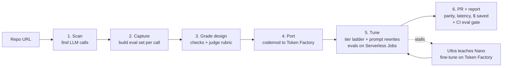

# OpenPort: build plan

**Hackathon:** Nebius x NVIDIA Global AI Hackathon
**Track:** Coding and Agentic Engineering. Also aiming for the Best Use of Tavily bonus and the Most Valuable Feedback prize.
**Deadline:** Fri Oct 30, 2026, 10:00am PT. **My target: submit Thu Oct 29 evening.**
**Team:** solo (with Claude Code). Full scope, nothing cut.

## Pitch

> Switching from GPT or Claude to an open model takes three lines of code. Almost nobody does it, because nobody can *prove* it won't break their product.
> OpenPort is an agent that moves your app onto NVIDIA Nemotron and proves it works.
> 1. It finds every LLM call in your repo.
> 2. It builds an eval for each one from your current outputs.
> 3. It rewrites the code for Nebius Token Factory.
> 4. It tunes each prompt until Nemotron matches, picking the cheapest model that passes (Nano, Super or Ultra).
> 5. It opens a PR with the evidence: a quality score and savings for every call.

Why this fits the judges: Token Factory's business is winning workloads from closed APIs, and the hackathon brief pushes "Ultra for reasoning, Nano/Super for the fast calls". OpenPort does that matching automatically, with numbers to back it up. Its own agent also uses all three model sizes for different jobs.

**Headline number** (the first thing a judge should see, in the video and at the top of every report):

> Swapping the base URL alone: **X% quality**. After OpenPort: **Y% quality**, at **Z% of the cost**.

## Facts checked (Oct 23)

- The Token Factory API is OpenAI-compatible. Base URL: `https://api.tokenfactory.nebius.com/v1/`, env var `NEBIUS_API_KEY`.
- Nebius's own [switch guide](https://docs.tokenfactory.nebius.com/switch) says that apart from the base URL, key and model name, "no other changes" are needed. That's only true for plain chat calls (see below).
- Tool calling uses the OpenAI format, including `tool_choice` (`auto` or a forced function). JSON / structured output has its own docs page.
- **There is no Anthropic-compatible API.** Code using the Anthropic SDK needs a real translation. The same goes for OpenAI's newer Responses API (`client.responses.create`), which has to become `chat.completions`. That's where the codemod does real work.
- `GET /v1/models?verbose=true` returns pricing per token, so Nebius-side costs can be read live.
- Token Factory offers fine-tuning (SFT and LoRA). That's what makes "Ultra teaches Nano" possible.
- Nemotron on Token Factory: Nano 30B-A3B (≈$0.06/$0.24 per 1M tokens in/out), Super 120B-A12B (≈$0.30/$0.90 per 1M), and Ultra 550B-A55B. **Day 1: confirm the exact model names via `/v1/models`.**

## How it works

1. **Scan.** Parse **Python and TypeScript** code (Python's `ast` module; tree-sitter for TS) to find OpenAI calls (`chat.completions`, `responses`) and Anthropic calls (`messages`). For each call, Nano labels what kind of task it is (classify, extract, summarize, generate, agent with tools) and records the prompt template, parameters and expected output shape.
2. **Capture.** Build an eval set for each call.
   - Main source: import logged inputs and outputs (JSONL).
   - Fallback: Super writes realistic test inputs, and I run them once through the *original* model to record reference outputs, using the user's existing key.
   - The demo repos ship with these reference outputs saved, so judges never need a closed-model key.
3. **Grade design.** For each call, Ultra writes a grader. Strict checks come first: schema valid, exact label match, required fields, correct tool name and arguments. A rubric or blind side-by-side comparison against the reference output handles free text.
4. **Port.** A codemod points every call at Token Factory and routes them through one small module (`openport_llm.py` / `openportLlm.ts`), with each call's model set in `openport.yaml`. It translates Anthropic Messages to OpenAI chat format:
   - the system parameter becomes a system message
   - content blocks become plain message content
   - `input_schema` becomes `parameters`
   - `tool_use` / `tool_result` become `tool_calls` and `tool` messages

   It also converts the OpenAI Responses API to chat completions. Super does the rewriting; its 1M-token context window fits the whole repo.
5. **Tune.** For each call site:
   - **Baseline first:** run the eval on a plain base-URL swap to get the "before" number for the headline.
   - Start on Nano. Run the eval, and if it misses the target score, Ultra reads the failures and rewrites the prompt (few-shot examples, format instructions, reasoning on or off). Retry.
   - **Tavily research step:** when a failure looks model-specific (chat template, reasoning toggle, JSON quirks), Tavily searches NVIDIA's Nemotron docs and model cards and feeds the guidance into Ultra's rewrite.
   - After N rounds without passing, move up to Super, then Ultra.
   - Eval runs are spread across **Nebius Serverless Jobs**, so each round runs in parallel.
   - **Ultra teaches Nano:** if prompt rewrites stall on a high-volume call, Ultra generates training outputs and OpenPort starts a Nano fine-tune on Token Factory. The tuned Nano then goes back through the same eval. Train only on Ultra-generated outputs, never closed-model outputs; their terms forbid using outputs to build competing models.
6. **PR and report.** Open a GitHub PR with:
   - the code diff
   - a table per call: chosen model, quality score vs. the original, latency, cost per 1k calls before and after
   - projected monthly savings
   - a **GitHub Action** that re-runs the eval on every PR so quality can't silently slip

   Nebius prices come from `/v1/models`. Closed-model prices are fetched live with **Tavily**.

### Which model does what inside OpenPort (shown on screen as a live cost meter)

| Job | Model | Why |
|---|---|---|
| Labelling calls, cheap grading, triaging failures | Nemotron 3 Nano | High volume, simple |
| Codemod, test-input generation | Nemotron 3 Super | Long context, solid code |
| Grader design, failure analysis, prompt rewrites, fine-tune data | Nemotron 3 Ultra | Needs real reasoning |

## Product

- **Web dashboard** (this is the hosted demo URL). Paste a repo URL and watch it work live:
  - a card per call that goes from red to amber to green
  - a model badge on each card that moves up the ladder when needed
  - a running cost meter for OpenPort itself
  - the "plain swap vs. OpenPort" headline number
  - then the PR link and the report

  Vite + React frontend; FastAPI backend sending live updates via server-sent events. Deployed as a container on a **Nebius Serverless Endpoint**.
- **CLI** for developers: `openport scan | port | tune | pr`. A thin layer over the same code the dashboard calls.
- **GitHub Action** (`openport/eval-gate`) for CI.
- The demo repos come preloaded so judges can click one button.

## Demo targets

**1. "SupportDesk"**, a small FastAPI app I write myself, with 5 deliberately different LLM calls so the results spread across model sizes:

| # | Call | Original SDK | Shape | Expected result |
|---|---|---|---|---|
| 1 | Ticket classifier | OpenAI chat | JSON label | Nano |
| 2 | PII extraction | OpenAI structured outputs | JSON schema | Nano (after a prompt rewrite) |
| 3 | Reply drafter | Anthropic messages | Free text, tone | Super |
| 4 | Refund agent | OpenAI tools | Tool calls | Super |
| 5 | Policy-exception reasoning | Anthropic messages | Multi-step reasoning | Ultra |

**2. Real open-source repos I didn't write.** This answers "you built the demo app to pass". All are MIT; checked Oct 23.

| Repo | Lang | SDK | Why | Watch out for |
|---|---|---|---|---|
| **[jsliapark/preflight](https://github.com/jsliapark/preflight)** (main Python pick) | Python, ~1.9k lines | Anthropic, hardcoded `claude-opus-4-5` | An AI PR reviewer, which fits the coding track. 4 agents with JSON output. Opus → Nemotron is the biggest savings story. `test_evals.py` has labelled diffs (SQL injection, clean, N+1), so there's ground truth without closed-model keys. | Only 8 stars. The standards agent needs ChromaDB (an in-memory client works). Its tests call the live API. |
| [dannwaneri/seo-agent](https://github.com/dannwaneri/seo-agent) (Python backup) | Python, ~5.2k lines | Anthropic (Sonnet 4, Haiku 4.5) | 6 call sites, almost all JSON. Active in Sept 2026. 54 stars. | The core audit needs Playwright/Browser Use; use the four standalone modules. No labels, so evals need generated test inputs and an Ultra reference. |
| **[PragmaticMachineLearning/probly](https://github.com/PragmaticMachineLearning/probly)** (TS pick) | TypeScript (Next.js), ~4.6k lines | OpenAI | 890 stars. Real tool calling (spreadsheet cells, charts, Python). | Last real commit April 2025. One call sends an image: OpenPort should flag it, which is a good demo moment. Route it to a vision model or leave it on the original. No tests. |
| [antiwork/jacquez](https://github.com/antiwork/jacquez) (TS backup) | TypeScript, ~3.3k lines | Anthropic | Real prompts, tests exist. | Only 2 calls, both using Claude-specific assistant prefill and `cache_control`. The runtime doesn't translate prefill yet. |

Rejected: repos that already read a base URL from config (nothing to port), multi-provider apps, and toy samples.

**3. A TypeScript version of SupportDesk** (or probly) to show TS support works end to end.

## 3-minute video script

- **0:00–0:20 The problem.** "Switching to open models is a base-URL change. So why doesn't anyone do it? Nobody can prove it won't break." Show the headline number: plain swap X% → OpenPort Y%.
- **0:20–0:40** Paste the SupportDesk URL. The scan finds 5 calls across the OpenAI and Anthropic SDKs.
- **0:40–1:30** The tuning board, live:
  - Nano fails one call at 72% → Tavily pulls Nemotron guidance → Ultra rewrites the prompt → 96% → locked.
  - Another call moves up to Super.
  - Evals spread out across Serverless Jobs, and the cost meter keeps ticking.
- **1:30–1:50** Ultra teaches Nano: the fine-tuned Nano passes a call that plain Nano couldn't.
- **1:50–2:20** The PR opens: the diff, the quality table, savings, and the CI gate catching a deliberately broken prompt. Quick cut to the real open-source repo's PR.
- **2:20–2:45** Architecture: which Nemotron model does what, Token Factory, Serverless Jobs and Endpoints, fine-tuning, Tavily.
- **2:45–3:00** Close: "Prove it, then port it."

## Schedule

| Day | Goal |
|---|---|
| **Fri 23** | Claim credits (code `NEBIUS-DEVPOST-GLOBAL26` + Builders Program), get API keys, create repo + MIT license. Smoke-test tool calling and JSON output on Nano, Super and Ultra. Write SupportDesk with saved reference outputs. **Measure the plain-swap baseline** to confirm there's a real quality gap to close. Pick the real open-source demo repo(s). |
| **Sat 24** | Scanner (Python + TS), eval harness, graders. |
| **Sun 25** | Tuning loop (model ladder, Ultra rewriter, Tavily research step) + spreading evals across Serverless Jobs. |
| **Mon 26** | Codemod (OpenAI chat + Responses + Anthropic, Python + TS), PR creation, report with Tavily prices, GitHub Action. Generate Ultra training data and **start the first Nano fine-tune**: it takes hours, so it runs overnight. |
| **Tue 27** | React dashboard with live updates and the cost meter; deploy to a Nebius Serverless Endpoint; CLI. Plug the fine-tuned Nano back into the model ladder. |
| **Wed 28** | Full runs on SupportDesk (Py + TS) and the real open-source repos; fix bugs; README. |
| **Thu 29** | Record the video, write the feedback section, **submit**. |
| Fri 30 | Buffer only (closes 10:00am PT). |

### Progress

**Fri 23 (done):**
- Repo scaffolded (MIT, uv, Python 3.13).
- Token Factory client with automatic Nemotron tier detection and live pricing.
- `openport_llm` runtime: OpenAI SDK calls work on Token Factory unchanged; Anthropic SDK calls are translated.
- `openport smoke` / `models` / `baseline` CLI.
- SupportDesk with 5 call sites and 54 hand-labelled eval cases.
- 17 offline tests passing.

**Day 2 scanner (done early, Fri 23):** `openport scan <folder | owner/repo>`.
- Python via `ast`, TypeScript/JavaScript via tree-sitter. Code is parsed, never run.
- For each call it finds: SDK and API, model (resolved from constants), how the client is reached, and output type. The output type comes from following the data into `json.loads`/`JSON.parse`, stopping at other LLM calls.
- Porting flags: structured output, JSON mode, tools, thinking, streaming, vision, prefill, ends-on-assistant, `cache_control`, dynamic arguments, base URL already configurable.
- Each call is marked auto / translate / review.
- Verified on SupportDesk (5/5), preflight (4/4) and probly (4/4); the last two match the helper agent's manual review.
- 21 offline tests.

**Mon 26 codemod, mechanical part (done early, Fri 23):** `openport port <folder | owner/repo>`.
- **Clients:** finds where each call's client is built (module global, a factory in another module like preflight's `get_client()`, `self.client`, or a local) and swaps the constructor for the runtime helper. Provider-only options are dropped; `timeout` and similar are kept.
- **Models:** sets each call's model, editing a shared constant once when all its users move to the same model, and adds `# was "..."` comments.
- **Imports:** adds the runtime import; removes SDK imports only when nothing uses them.
- **Shared clients:** split when they also serve a call that stays put.
- **Warnings:** Anthropic exception handlers are flagged.
- **TypeScript:** OpenAI calls only, by setting the base URL and key inline (no runtime needed).
- **Output:** the original is never modified; the copy gets `openport.yaml`.
- Verified on SupportDesk (5/5, and the ported package imports cleanly), preflight (4/4) and probly (3/4, image call kept).
- 28 offline tests.
- Not yet: rewriting Anthropic code natively as chat completions (Super's job), and Anthropic in TypeScript.

**Sun 25 tuning loop (built early, Fri 23; not run live yet):** `openport tune <target>`.
- **Ladder:** Nano as written (the baseline), then up to 3 rounds where Ultra proposes a variant, then Super, then Ultra.
- **Variant knobs**, applied at the client so app code is untouched during tuning: system-prompt addendum, reasoning on/off, a `max_tokens` floor, temperature.
- **Held-out cases:** a stable ~30% split; the engineer only sees tuning-case failures, and a variant must pass both sets.
- **Engineer rules:** fix the class of failure, never quote expected answers.
- **Output:** a plan for `openport port --plan`. The reasoning switch is written into the code; addendum, `max_tokens` and temperature appear as "Tuned:" notes for now.
- 34 offline tests.
- Next: write the tuned addendum into the prompt's source (find it by searching for the text the app sends).

**Still open for Fri 23:**
- Add API keys, then run `openport smoke` and `openport baseline examples/supportdesk`.
- Create the public GitHub repo.
- Done: demo repos chosen (preflight + probly; see Demo targets).

Keep a running `FEEDBACK.md` all week. Every friction point with Token Factory, Nemotron, Serverless or fine-tuning goes in it. It's free material for the feedback prize.

**Daily rule:** each day's work runs end to end before you stop.

## Phase 2: `openport upgrade` (security updates), after the core demo works end to end

The same "prove it, then ship it" engine, second kind of PR: patch vulnerable dependencies and fix the code the upgrade breaks.

1. **Find vulnerable versions:** read lockfiles (`uv.lock`, `poetry.lock`, `requirements*.txt`, `package-lock.json`, `pnpm-lock.yaml`) and query the OSV.dev API (free, no key).
2. **Pick the target version:** the earliest version that fixes the advisory and is at least N days old (default 7). Recent supply-chain attacks shipped malicious *new* releases, so never jump to the newest one the day it lands.
3. **Research the change:** Tavily fetches the advisory, changelog and migration guide (all newer than any model's training data). This is the central Tavily use.
4. **Fix the code:** Super patches call sites the upgrade breaks, using OpenPort's byte-precise edits.
5. **Prove it:** run the repo's own test suite before and after (Nebius Serverless Jobs for parallel runs).
6. **Ship:** a PR with the advisory, the version jump and why, code changes, and test results. Never auto-merge.

Pitch: "OpenPort keeps your app open and current. It moves your LLM calls onto open models, patches vulnerable packages, and every change ships as a PR with proof."

## Risks

- **Plain swap turns out nearly perfect.** If Nemotron matches on day 1 with no changes, the "before" number isn't dramatic. Fix: make SupportDesk realistic and tricky (strict JSON schemas, tricky tool arguments, Anthropic-specific features). And lean on the honest framing: "OpenPort *proved* it's safe" is still the product.
- **Nemotron tool calling / JSON reliability on Token Factory.** Smoke-test on day 1 before building on it.
- **The judge model favouring its own family** (Ultra grading Nemotron). Use strict checks first, blind side-by-side comparisons, and report how often the judge agrees with the strict checks.
- **Synthetic test inputs not matching real traffic.** Make imported logs the main path and say so in the README.
- **Fine-tune turnaround.** Start it Monday night so a slow job doesn't block the demo.
- **Name clash:** openport.io (a port-forwarding tool) exists. Fine for a hackathon; alternatives: *Defector*, *OpenSwitch*, *Parity*.

## Stack

- Backend / agent: Python 3.12, FastAPI, the `openai` SDK pointed at Token Factory, `tavily-python`, tree-sitter for the TypeScript scan, and the GitHub REST API for branches and PRs.
- Frontend: Vite + React + Tailwind, live updates via server-sent events.
- Compute: Token Factory (inference + fine-tuning), Nebius Serverless Jobs (eval runs), Nebius Serverless Endpoint (hosting).
- CI: a GitHub Action wrapping the CLI's eval command.
