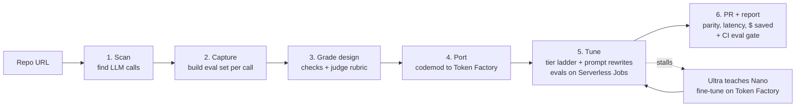

# OpenPort: build plan

**Hackathon:** Nebius x NVIDIA Global AI Hackathon
**Track:** Coding and Agentic Engineering. Also aiming for the Best Use of Tavily bonus and the Most Valuable Feedback prize.
**Deadline:** Fri Oct 30, 2026, 10:00am PT. **My target: submit Thu Oct 29 evening.**
**Team:** solo (with Claude Code). Full scope, nothing cut.

## Pitch

> Switching from GPT or Claude to an open model takes three lines of code. Almost nobody does it, because nobody can *prove* it won't break their product.
> OpenPort is an agent that moves your app onto NVIDIA Nemotron and proves it works.
> 1. It finds every LLM call in your repo.
> 2. It builds an eval for each one from your current outputs.
> 3. It rewrites the code for Nebius Token Factory.
> 4. It tunes each prompt until Nemotron matches, picking the cheapest model that passes (Nano, Super or Ultra).
> 5. It opens a PR with the evidence: a quality score and savings for every call.

Why this fits the judges: Token Factory's business is winning workloads from closed APIs, and the hackathon brief pushes "Ultra for reasoning, Nano/Super for the fast calls". OpenPort does that matching automatically, with numbers to back it up. Its own agent also uses all three model sizes for different jobs.

**Headline number** (the first thing a judge should see, in the video and at the top of every report):

> Swapping the base URL alone: **X% quality**. After OpenPort: **Y% quality**, at **Z% of the cost**.

## Facts checked (Oct 23)

- The Token Factory API is OpenAI-compatible. Base URL: `https://api.tokenfactory.nebius.com/v1/`, env var `NEBIUS_API_KEY`.
- Nebius's own [switch guide](https://docs.tokenfactory.nebius.com/switch) says that apart from the base URL, key and model name, "no other changes" are needed. That's only true for plain chat calls (see below).
- Tool calling uses the OpenAI format, including `tool_choice` (`auto` or a forced function). JSON / structured output has its own docs page.
- **There is no Anthropic-compatible API.** Code using the Anthropic SDK needs a real translation. The same goes for OpenAI's newer Responses API (`client.responses.create`), which has to become `chat.completions`. That's where the codemod does real work.
- `GET /v1/models?verbose=true` returns pricing per token, so Nebius-side costs can be read live.
- Token Factory offers fine-tuning (SFT and LoRA). That's what makes "Ultra teaches Nano" possible.
- Nemotron on Token Factory: Nano 30B-A3B (≈$0.06/$0.24 per 1M tokens in/out), Super 120B-A12B (≈$0.30/$0.90 per 1M), and Ultra 550B-A55B. **Day 1: confirm the exact model names via `/v1/models`.**

## How it works

1. **Scan.** Parse **Python and TypeScript** code (Python's `ast` module; tree-sitter for TS) to find OpenAI calls (`chat.completions`, `responses`) and Anthropic calls (`messages`). For each call, Nano labels what kind of task it is (classify, extract, summarize, generate, agent with tools) and records the prompt template, parameters and expected output shape.
2. **Capture.** Build an eval set for each call.
   - Main source: import logged inputs and outputs (JSONL).
   - Fallback: Super writes realistic test inputs, and I run them once through the *original* model to record reference outputs, using the user's existing key.
   - The demo repos ship with these reference outputs saved, so judges never need a closed-model key.
3. **Grade design.** For each call, Ultra writes a grader. Strict checks come first: schema valid, exact label match, required fields, correct tool name and arguments. A rubric or blind side-by-side comparison against the reference output handles free text.
4. **Port.** A codemod points every call at Token Factory and routes them through one small module (`openport_llm.py` / `openportLlm.ts`), with each call's model set in `openport.yaml`. It translates Anthropic Messages to OpenAI chat format:
   - the system parameter becomes a system message
   - content blocks become plain message content
   - `input_schema` becomes `parameters`
   - `tool_use` / `tool_result` become `tool_calls` and `tool` messages

   It also converts the OpenAI Responses API to chat completions. Super does the rewriting; its 1M-token context window fits the whole repo.
5. **Tune.** For each call site:
   - **Baseline first:** run the eval on a plain base-URL swap to get the "before" number for the headline.
   - Start on Nano. Run the eval, and if it misses the target score, Ultra reads the failures and rewrites the prompt (few-shot examples, format instructions, reasoning on or off). Retry.
   - **Tavily research step:** when a failure looks model-specific (chat template, reasoning toggle, JSON quirks), Tavily searches NVIDIA's Nemotron docs and model cards and feeds the guidance into Ultra's rewrite.
   - After N rounds without passing, move up to Super, then Ultra.
   - Eval runs are spread across **Nebius Serverless Jobs**, so each round runs in parallel.
   - **Ultra teaches Nano:** if prompt rewrites stall on a high-volume call, Ultra generates training outputs and OpenPort starts a Nano fine-tune on Token Factory. The tuned Nano then goes back through the same eval. Train only on Ultra-generated outputs, never closed-model outputs; their terms forbid using outputs to build competing models.
6. **PR and report.** Open a GitHub PR with:
   - the code diff
   - a table per call: chosen model, quality score vs. the original, latency, cost per 1k calls before and after
   - projected monthly savings
   - a **GitHub Action** that re-runs the eval on every PR so quality can't silently slip

   Nebius prices come from `/v1/models`. Closed-model prices are fetched live with **Tavily**.

### Which model does what inside OpenPort (shown on screen as a live cost meter)

| Job | Model | Why |
|---|---|---|
| Labelling calls, cheap grading, triaging failures | Nemotron 3 Nano | High volume, simple |
| Codemod, test-input generation | Nemotron 3 Super | Long context, solid code |
| Grader design, failure analysis, prompt rewrites, fine-tune data | Nemotron 3 Ultra | Needs real reasoning |

## Product

- **Web dashboard** (this is the hosted demo URL). Paste a repo URL and watch it work live:
  - a card per call that goes from red to amber to green
  - a model badge on each card that moves up the ladder when needed
  - a running cost meter for OpenPort itself
  - the "plain swap vs. OpenPort" headline number
  - then the PR link and the report

  Vite + React frontend; FastAPI backend sending live updates via server-sent events. Deployed as a container on a **Nebius Serverless Endpoint**.
- **CLI** for developers: `openport scan | port | tune | pr`. A thin layer over the same code the dashboard calls.
- **GitHub Action** (`openport/eval-gate`) for CI.
- The demo repos come preloaded so judges can click one button.

## Demo targets

**1. "SupportDesk"**, a small FastAPI app I write myself, with 5 deliberately different LLM calls so the results spread across model sizes:

| # | Call | Original SDK | Shape | Expected result |
|---|---|---|---|---|
| 1 | Ticket classifier | OpenAI chat | JSON label | Nano |
| 2 | PII extraction | OpenAI structured outputs | JSON schema | Nano (after a prompt rewrite) |
| 3 | Reply drafter | Anthropic messages | Free text, tone | Super |
| 4 | Refund agent | OpenAI tools | Tool calls | Super |
| 5 | Policy-exception reasoning | Anthropic messages | Multi-step reasoning | Ultra |

**2. Real open-source repos I didn't write.** This answers "you built the demo app to pass". All are MIT; checked Oct 23.

| Repo | Lang | SDK | Why | Watch out for |
|---|---|---|---|---|
| **[jsliapark/preflight](https://github.com/jsliapark/preflight)** (main Python pick) | Python, ~1.9k lines | Anthropic, hardcoded `claude-opus-4-5` | An AI PR reviewer, which fits the coding track. 4 agents with JSON output. Opus → Nemotron is the biggest savings story. `test_evals.py` has labelled diffs (SQL injection, clean, N+1), so there's ground truth without closed-model keys. | Only 8 stars. The standards agent needs ChromaDB (an in-memory client works). Its tests call the live API. |
| [dannwaneri/seo-agent](https://github.com/dannwaneri/seo-agent) (Python backup) | Python, ~5.2k lines | Anthropic (Sonnet 4, Haiku 4.5) | 6 call sites, almost all JSON. Active in Sept 2026. 54 stars. | The core audit needs Playwright/Browser Use; use the four standalone modules. No labels, so evals need generated test inputs and an Ultra reference. |
| **[PragmaticMachineLearning/probly](https://github.com/PragmaticMachineLearning/probly)** (TS pick) | TypeScript (Next.js), ~4.6k lines | OpenAI | 890 stars. Real tool calling (spreadsheet cells, charts, Python). | Last real commit April 2025. One call sends an image: OpenPort should flag it, which is a good demo moment. Route it to a vision model or leave it on the original. No tests. |
| [antiwork/jacquez](https://github.com/antiwork/jacquez) (TS backup) | TypeScript, ~3.3k lines | Anthropic | Real prompts, tests exist. | Only 2 calls, both using Claude-specific assistant prefill and `cache_control`. The runtime doesn't translate prefill yet. |

Rejected: repos that already read a base URL from config (nothing to port), multi-provider apps, and toy samples.

**3. A TypeScript version of SupportDesk** (or probly) to show TS support works end to end.

## 3-minute video script (full scope, including the package updater)

The full voiceover, shot list and recording runbook are in [docs/VIDEO.md](docs/VIDEO.md); this is the outline.

- **0:00–0:15 The problem.** "Switching to open models is a three-line change. Almost nobody does it, because nobody can prove it won't break." Headline: plain swap **74%** (measured Oct 24, Nano) → OpenPort **Y%**, at **Z%** of the cost.
- **0:15–0:30** Paste SupportDesk into the dashboard. The scan finds 5 calls across the OpenAI and Anthropic SDKs.
- **0:30–1:10** The tuning board, live:
  - Nano misses a call → Tavily pulls Nemotron guidance → Ultra rewrites the prompt → it passes → locked.
  - Another call climbs to Super.
  - Evals fan out across Serverless Jobs, and the cost meter keeps ticking.
- **1:10–1:25** Ultra teaches Nano: the fine-tuned Nano passes a call that plain Nano couldn't.
- **1:25–1:50** The PR: the tuned prompt written into the code, the quality table, cost per 1k calls before and after, and the CI gate catching a deliberately broken prompt. Quick cut to the real open-source repo's (preflight) PR.
- **1:50–2:20** `openport upgrade`: it finds a vulnerable dependency, picks a fix that's at least a week old, Tavily reads the advisory and changelog, Super patches the code the upgrade breaks, the repo's tests pass before and after, and a second PR opens.
- **2:20–2:45** Architecture: which Nemotron tier does what; Token Factory, Serverless Jobs and Endpoints, fine-tuning, Tavily.
- **2:45–3:00** Close: "OpenPort keeps your app open and current. Prove it, then ship it."

### Submission requirements (from the Devpost page, checked Oct 24)

- **Video:** 3 minutes or shorter, a **public YouTube** video showing the project working and how it uses Token Factory and Nemotron.
- **Code:** a **public** repository with an open-source license visible at the top (MIT is in place; the repo is private until I submit).
- **Working demo:** a URL to a hosted app or test build. The dashboard needs to be deployed (a Nebius Serverless Endpoint is encouraged).
- **README:** setup instructions, how OpenPort uses Nemotron, where Token Factory helped, and any other Nebius tools used.
- **Feedback** on Token Factory, AI Cloud and the NVIDIA models (FEEDBACK.md).
- **Credits:** $25 of Token Factory credits via the [promo form](https://nebius.com/promo-code?utm_promo_event_code=2026-devpost-global-ai-hack&utm_promo_code_type=Token_Factory&utm_promo_activation_code=NEBIUS-DEVPOST-GLOBAL26) (activation code `NEBIUS-DEVPOST-GLOBAL26`), plus another $25 (and Tavily credits) by joining the free [Nebius Builders Program](https://dev.nebius.com/builders).

## Schedule

| Day | Goal |
|---|---|
| **Fri 23** | Claim credits (code `NEBIUS-DEVPOST-GLOBAL26` + Builders Program), get API keys, create repo + MIT license. Smoke-test tool calling and JSON output on Nano, Super and Ultra. Write SupportDesk with saved reference outputs. **Measure the plain-swap baseline** to confirm there's a real quality gap to close. Pick the real open-source demo repo(s). |
| **Sat 24** | Scanner (Python + TS), eval harness, graders. |
| **Sun 25** | Tuning loop (model ladder, Ultra rewriter, Tavily research step) + spreading evals across Serverless Jobs. |
| **Mon 26** | Codemod (OpenAI chat + Responses + Anthropic, Python + TS), PR creation, report with Tavily prices, GitHub Action. Generate Ultra training data and **start the first Nano fine-tune**: it takes hours, so it runs overnight. |
| **Tue 27** | React dashboard with live updates and the cost meter; deploy to a Nebius Serverless Endpoint; CLI. Plug the fine-tuned Nano back into the model ladder. |
| **Wed 28** | Full runs on SupportDesk (Py + TS) and the real open-source repos; fix bugs; README. |
| **Thu 29** | Record the video, write the feedback section, **submit**. |
| Fri 30 | Buffer only (closes 10:00am PT). |

### Progress

**Fri 23 (done):**
- Repo scaffolded (MIT, uv, Python 3.13).
- Token Factory client with automatic Nemotron tier detection and live pricing.
- `openport_llm` runtime: OpenAI SDK calls work on Token Factory unchanged; Anthropic SDK calls are translated.
- `openport smoke` / `models` / `baseline` CLI.
- SupportDesk with 5 call sites and 54 hand-labelled eval cases.
- 17 offline tests passing.

**Day 2 scanner (done early, Fri 23):** `openport scan <folder | owner/repo>`.
- Python via `ast`, TypeScript/JavaScript via tree-sitter. Code is parsed, never run.
- For each call it finds: SDK and API, model (resolved from constants), how the client is reached, and output type. The output type comes from following the data into `json.loads`/`JSON.parse`, stopping at other LLM calls.
- Porting flags: structured output, JSON mode, tools, thinking, streaming, vision, prefill, ends-on-assistant, `cache_control`, dynamic arguments, base URL already configurable.
- Each call is marked auto / translate / review.
- Verified on SupportDesk (5/5), preflight (4/4) and probly (4/4); the last two match the helper agent's manual review.
- 21 offline tests.

**Mon 26 codemod, mechanical part (done early, Fri 23):** `openport port <folder | owner/repo>`.
- **Clients:** finds where each call's client is built (module global, a factory in another module like preflight's `get_client()`, `self.client`, or a local) and swaps the constructor for the runtime helper. Provider-only options are dropped; `timeout` and similar are kept.
- **Models:** sets each call's model, editing a shared constant once when all its users move to the same model, and adds `# was "..."` comments.
- **Imports:** adds the runtime import; removes SDK imports only when nothing uses them.
- **Shared clients:** split when they also serve a call that stays put.
- **Warnings:** Anthropic exception handlers are flagged.
- **TypeScript:** OpenAI calls only, by setting the base URL and key inline (no runtime needed).
- **Output:** the original is never modified; the copy gets `openport.yaml`.
- Verified on SupportDesk (5/5, and the ported package imports cleanly), preflight (4/4) and probly (3/4, image call kept).
- 28 offline tests.
- Not yet: rewriting Anthropic code natively as chat completions (Super's job), and Anthropic in TypeScript.

**Sun 25 tuning loop (built early, Fri 23; not run live yet):** `openport tune <target>`.
- **Ladder:** Nano as written (the baseline), then up to 3 rounds where Ultra proposes a variant, then Super, then Ultra.
- **Variant knobs**, applied at the client so app code is untouched during tuning: system-prompt addendum, reasoning on/off, a `max_tokens` floor, temperature.
- **Held-out cases:** a stable ~30% split; the engineer only sees tuning-case failures, and a variant must pass both sets.
- **Engineer rules:** fix the class of failure, never quote expected answers.
- **Output:** a plan for `openport port --plan`. The reasoning switch is written into the code; addendum, `max_tokens` and temperature appear as "Tuned:" notes for now.
- 34 offline tests.
- Next: write the tuned addendum into the prompt's source (find it by searching for the text the app sends).

**Sat 24: tuned changes, pricing, PR (built offline; not run live yet):**
- **Prompt additions** go where each prompt is written:
  - string literals in Python (plain, triple-quoted, f-strings, `.format()` templates with braces escaped)
  - TypeScript strings and template literals, followed through local variables, `as` casts and imports
  - prompt files (`.md`, `.txt`), found by searching for the exact text the app sent during tuning
- **Settings:** `max_tokens` (raised, never lowered), `temperature` and the reasoning switch are written as arguments, matching each call's layout.
- **Pricing** (`pricing.py`): Tavily searches only the providers' own pricing pages and Nano reads out the numbers. A price is accepted only if both numbers appear in the cited page; prices are cached and can be overridden by hand.
- **`openport pr`:** a dry run by default; it writes the description and shows the git/gh commands. `--open` pushes to your fork and opens the PR there (`--upstream` to propose it to the original repo).
- 39 offline tests.

**Sat 24: quality gate and dashboard (built; checked offline with a fake Token Factory):**
- **`openport check`:** runs a repo's evals on the models its code names now; exits 1 below the bar.
  - The port records the eval spec and the bar in `openport.yaml` and adds `.github/workflows/openport.yml` (needs a `NEBIUS_API_KEY` secret).
  - Evals can now swap factory clients (`client_attr: get_client()`).
- **Dashboard backend** (`openport serve`): FastAPI runs fetch → scan → tune → port → PR as a job and streams events over SSE.
  - Safety: only presets and `owner/name` repos are accepted, one pipeline runs at a time, a recent run of the same target is reused, and it never opens PRs.
- **Dashboard frontend** (Vite + React + Tailwind):
  - launcher with presets, a stage tracker, and headline tiles (plain swap vs. after OpenPort, held-out, OpenPort's own cost, cost per 1k calls)
  - a card per call with its tuning ladder, a diff viewer, and the rendered PR (sanitized)
  - checked at phone width, no overflow
- 44 Python tests.
- **Biggest gap for real repos:** no eval spec means no tuning. Next: `openport capture`, a starter eval set per call: import logs, seed from the repo's own test data (preflight's labelled diffs), or have Super write inputs and the original model or Ultra label them, flagged for human review.

**Sat 24: `openport capture` (built; checked offline):** `openport capture <folder | owner/repo>`.
- Drafts a starter `openport.evals.yaml` from a scan (code parsed, never run): one call site per LLM call, with a client the runner can swap, a grader inferred from the output shape (field checks for JSON and tool calls, a Nemotron Ultra judge for free text), and a `<id>.jsonl` dataset.
- **Cases:** imported from a recorded-call log (`--logs ID=PATH`), or, with no logs, generated — Super invents realistic inputs and Ultra labels graded outputs (`--generate N`), flagged for review.
- Calls the harness can't run yet (TypeScript, methods, clients it can't bind at import, non-evaluable outputs) are skipped and listed in `CAPTURE_NOTES.md`.
- Verified on SupportDesk: with its logs it reproduces the hand-written spec's graders and datasets; the captured spec loads, imports every call and reads its cases. 62 offline tests.
- This closes the "no eval spec means no tuning" gap: a real repo can now go scan -> capture -> tune.
- **Wired into the dashboard pipeline:** when a pasted repo has no eval spec, the pipeline now runs a `capture` stage (bounded, `OPENPORT_CAPTURE_CASES`, default 6), emits a `captured` event flagged as unreviewed, and tunes on the generated spec instead of porting untuned. 63 offline tests.
- **Labelling choice:** `--label-with ultra` (default) or `--label-with original`, which labels generated cases by running the app through its original closed model instead of Ultra (needs that provider's key; this one does execute the repo). 66 offline tests.

**Phase 2 `openport upgrade` started (built offline; dry run only):** `openport upgrade <folder | owner/repo>`.
- **Lockfiles:** reads installed versions from Python (`requirements*.txt`, `uv.lock`, `poetry.lock`) and Node (`package-lock.json` v1/v2/v3, `pnpm-lock.yaml`) lockfiles; parsed, never installed.
- **Advisories:** queries OSV.dev per dependency at its installed version (free, no key) and extracts the fixed versions.
- **Safe target:** picks the lowest stable release that fixes every advisory, is newer than installed, and is at least `--min-age` days old (default 7) — the supply-chain guard against freshly-published malicious releases; holds if the only fix is too new.
- **CLI:** a dry-run report (vulnerable deps, installed -> fix, advisory IDs, status). 86 offline tests.
- **Done (Oct 24): `--apply`.** It upgrades a copy, runs the repo's tests in Docker before and after, has Tavily read the changelog and advisory, and has Super fix application code (exact edits; edits to tests are rejected). It writes the diff and PR description.
  - On real OSV data, selection now fixes what it safely can (one disputed advisory without a fix no longer blocks PyJWT), follows OSV's per-branch ranges, and counts each flaw once (GHSA and PYSEC records merged).
  - Live on `examples/authkit`: PyJWT 1.7.1 → 2.14.0 and requests 2.31.0 → 2.33.0 fix 15 advisories. Tests: 5 passed before; 4 failed after the bump; Super dropped `.decode()` (2 still failing), then added `algorithms=["HS256"]` → 5 passed. **Proven.** One proposed edit was rejected by the exact-match guard.
- Done (Oct 24): `--open` (a proven upgrade only), and lockfile bumps: `uv.lock` through `uv lock --upgrade-package`, `package-lock.json` through `npm install --package-lock-only` (an `overrides` entry for transitive packages), both in a container and resolving nothing newer than the age cutoff (`--exclude-newer`, `--before`). Tests run the project's way (pip, uv or `npm test`). Checked live: `authkit-node` (jsonwebtoken 8.5.1 → 9.0.0, 5 passed before and after) and a uv project (requests 2.31.0 → 2.33.0). If Super can't be reached, the run ends with a note instead of crashing.
- Still to do: poetry.lock and pnpm-lock.yaml bumps; run the test jobs on Serverless Jobs.

**Sat 24: first live runs on Token Factory.**
- `openport smoke`: JSON mode, tool calling (auto, forced, round trip) and the reasoning switch work on all three tiers; strict `json_schema` fails on Nano (Super and Ultra pass).
- `openport baseline` (plain swap): **74%** Nano / **83%** Super / **85%** Ultra across 54 cases; the reply drafter scores 0% / 25% / 38%.
- `openport tune`: all 5 calls reach **100%** on both tuning and held-out cases. Chosen tiers: refunds and policy on Nano, pii and replies on Super, triage on Ultra. OpenPort's own cost: **$0.12**.
- **Headline: plain swap 74% → OpenPort 100% (54/54), at about 3% of the cost**: $50.68 → $1.69 per 1,000 calls of each, with all five closed-model prices read off the providers' own pages. Biggest wins: policy (Claude Opus → Nano) $25.07 → $0.31 per 1k; refunds (gpt-5 → Nano) $23.54 → $0.66; replies 0% → 100%. "Before" costs are estimates: Nemotron's measured token counts at the closed models' prices.
- Pricing fix: the first PR run missed gpt-5's price (one extraction attempt, which Nano can miss) and had pinned Sonnet 5.5's price on the Sonnet 5 page (the numbers happened to match). The lookup now retries, reads with reasoning off, and only accepts a page that names the exact model.
- Port and PR (dry run) from the plan: every tuned prompt addition and setting landed in the code, with nothing left for review.
- Found and fixed on the first live run: a Windows UTF-8 console crash.
- Next: grow the eval sets (held-out sets are only 3–5 cases, so one case can push a call up a tier — triage landed on Ultra, which costs more than gpt-5-mini: $0.11 → $0.35 per 1k).

**Sat 24: bigger eval sets, research and the final SupportDesk numbers.**
- Eval sets grown from 54 to 118 hand-labelled cases (held-out sets of 6–9), with a test that checks the labels against the app's own data.
- With the bigger sets, the small-set results didn't all hold: triage no longer needed Ultra, and the reply drafter's "100%" turned out to be lucky draws (its two failing cases both passed on rerun).
- Free text scored by a judge is now sampled twice per case (`samples: 2`); every sample counts against the same 90% bar.
- Tavily research step in tuning: on, with sources limited to the exact model. Measured honestly: following the model cards' generic sampling advice helped one call and hurt two (see FEEDBACK.md), so the engineer now treats it as background.
- **Final SupportDesk result (research on): 4 of 5 calls ported, each 95–100% with 100% held-out, at $42.82 → $1.63 per 1,000 runs of each call (96% less).** triage → Super, pii → Super as written, refunds (gpt-5) → Nano as written, policy (Claude Opus) → Nano. The reply drafter stays on Claude Sonnet: best tier 85%, under the bar. That's the job for the fine-tune ("Ultra teaches a smaller model").

**Sat 24 (afternoon): preflight end to end, the upgrade dashboard, and a sturdier tuner.**
- **preflight** ([jsliapark/preflight](https://github.com/jsliapark/preflight), 4 Claude Opus calls, no evals of its own): OpenPort's eval pack has 119 hand-labelled cases, checked the way preflight's own `test_evals.py` checks them, and is pinned to the reviewed commit `7a00fa2`. **All 4 calls ported: review → Super (97% / 92% held-out, every case sampled twice), diff_analyzer → Super (100% / 100%), standards → Nano as written (94% / 100%), pr_description → Nano as written (94% / 100%). $69.93 → $1.38 per 1,000 runs of each call (98% less).** Tuning cost about $0.10 per review run.
  - The first run's prompts reached Nemotron garbled (a bare `open()` on Windows uses cp1252); the CLI now runs in Python's UTF-8 mode.
  - The review call ate most of its `max_tokens=1024` on reasoning and its JSON came back cut off; the engineer read that as a format problem and switched reasoning off, which cost accuracy. It now hears when a reply hit the token limit, sees what it already tried with each score, and sees every system prompt a call sends (preflight's review loads one per pass). With those, it kept reasoning on and raised the budget to 4,096.
  - Runs of the same settings varied by up to 15 points held-out on 13 cases, so the review call now samples every case twice (both count).
  - Citations: the engineer had cited unrelated NVIDIA pages. A citation now needs the sentence it followed, checked word for word against the page Tavily returned, and the PR shows the quote.
- **Dashboard upgrade mode:** the launcher switches between "Port to Nemotron" and "Upgrade dependencies"; an upgrade run streams the advisories, the versions chosen, the tests before and after, each fix with its quoted sources, and the PR. Checked live on AuthKit: 5 passed → 4 failed → 5 passed after Super's second fix.
  - Found live and fixed: Super copied a line with the wrong indentation three rounds running, so no edit applied (now matched regardless of indentation, if exactly one place matches); Windows `write_text` turned edited files into CRLF; research cited other projects' bump PRs (now only the package's own pages and advisory databases).
  - `openport upgrade --apply --open` pushes a proven upgrade to your fork and opens the PR.
- **Hosted-demo safety:** testing a call imports the repo's code next to the API keys, so the Docker image sets `OPENPORT_RUN_REPO_CODE=vetted`: only the bundled demo apps and pinned eval packs run; other repos are scanned and ported untuned, and the launcher says so.
- **SupportDesk re-tuned with the improved tuner** (15:12): 4 of 5 ported again, now with triage on Nano (+28 words: 94% / 100% held-out), pii on Super (reasoning on, 1,024-token budget: 100% / 100%), refunds on Nano as written (96% / 100%) and policy on Nano (+47 words: 100% / 100%). The reply drafter still stays on Claude Sonnet (best 85%). Both instructions match rules the app already states.
- **Cost estimates were inflated:** the "before" cost used Nemotron's completion tokens, reasoning included, so a call that reasons a lot looked dearer on the closed model than it is. The meter now records the reply's own tokens and the PR charges the original model for the prompt and reply only. The numbers above (and the $69.93 / $52.57 "before" totals) still use the old estimate; **re-measure both once credits are back.**
- **Token Factory credits ran out at 15:16** (`402 insufficient_quota`); the final re-tunes failed before writing anything. Logged spend today is about $4–5 at catalog prices, so check the console for what was charged (the queued fine-tune may hold some) and whether the promo and Builders credits were applied.
- `openport tune --sites X` now keeps the other calls' results in the report and plan.
- **Fine-tune:** the Llama 3.1 8B LoRA job (209 training examples distilled from Ultra) processed its datasets in a minute, then sat at "running" with 0 steps for over an hour (FEEDBACK.md).
- 153 offline tests.

**Sat 24 (evening): TypeScript end to end (built and checked offline; the credits ran out first).**
- The eval harness runs TypeScript/JavaScript call sites on the OpenAI SDK: the app runs unchanged under Node (TypeScript through its own `tsx`, else Node's type stripping), and its SDK talks to a local stand-in for the OpenAI API that sends each request through the same swapped client as Python (model swap, the variant, metering, token-limit notes). The Node process gets no secrets from the environment.
- `examples/supportdesk-ts`: SupportDesk's triage (JSON mode), PII (JSON schema) and refund agent (tool loop) in TypeScript, on `openai` 7.37.0, graded on the Python app's own 77 cases. Offline tests drive the real app, through `tsx` and the real SDK, against a fake Token Factory, tool loop included. It's a dashboard preset, and the Docker image now carries Node and the example's dependencies.
- The TypeScript port now writes the reasoning switch into the call (`chat_template_kwargs`, with a `@ts-expect-error` because the OpenAI types don't know it); checked with `tsc`.
- `openport capture` drafts TypeScript calls too, when they're in an exported function and the project's dependencies are installed (a fresh probly clone isn't, so it's still skipped with that reason).
- Still to run live: `openport tune examples/supportdesk-ts` (needs credits).
- 162 offline tests.

**Still open for Fri 23:**
- Done (Oct 24): API keys added; `openport smoke` and `openport baseline examples/supportdesk` run live.
- Done (Oct 24): GitHub repo created at NMooreCo/openport (private until submission).
- Done (Oct 24): both credit grants requested (promo form and Builders Program).
- Done: demo repos chosen (preflight + probly; see Demo targets).

Keep a running `FEEDBACK.md` all week. Every friction point with Token Factory, Nemotron, Serverless or fine-tuning goes in it. It's free material for the feedback prize.

**Daily rule:** each day's work runs end to end before you stop.

## Phase 2: `openport upgrade` (security updates), after the core demo works end to end

The same "prove it, then ship it" engine, second kind of PR: patch vulnerable dependencies and fix the code the upgrade breaks.

1. **Find vulnerable versions:** read lockfiles (`uv.lock`, `poetry.lock`, `requirements*.txt`, `package-lock.json`, `pnpm-lock.yaml`) and query the OSV.dev API (free, no key).
2. **Pick the target version:** the earliest version that fixes the advisory and is at least N days old (default 7). Recent supply-chain attacks shipped malicious *new* releases, so never jump to the newest one the day it lands.
3. **Research the change:** Tavily fetches the advisory, changelog and migration guide (all newer than any model's training data). This is the central Tavily use.
4. **Fix the code:** Super patches call sites the upgrade breaks, using OpenPort's byte-precise edits.
5. **Prove it:** run the repo's own test suite before and after (Nebius Serverless Jobs for parallel runs).
6. **Ship:** a PR with the advisory, the version jump and why, code changes, and test results. Never auto-merge.

Pitch: "OpenPort keeps your app open and current. It moves your LLM calls onto open models, patches vulnerable packages, and every change ships as a PR with proof."

## Risks

- **Plain swap turns out nearly perfect.** If Nemotron matches on day 1 with no changes, the "before" number isn't dramatic. Fix: make SupportDesk realistic and tricky (strict JSON schemas, tricky tool arguments, Anthropic-specific features). And lean on the honest framing: "OpenPort *proved* it's safe" is still the product.
- **Nemotron tool calling / JSON reliability on Token Factory.** Smoke-test on day 1 before building on it.
- **The judge model favouring its own family** (Ultra grading Nemotron). Use strict checks first, blind side-by-side comparisons, and report how often the judge agrees with the strict checks.
- **Synthetic test inputs not matching real traffic.** Make imported logs the main path and say so in the README.
- **Fine-tune turnaround.** Start it Monday night so a slow job doesn't block the demo.
- **Name clash:** openport.io (a port-forwarding tool) exists. Fine for a hackathon; alternatives: *Defector*, *OpenSwitch*, *Parity*.

## Stack

- Backend / agent: Python 3.12, FastAPI, the `openai` SDK pointed at Token Factory, `tavily-python`, tree-sitter for the TypeScript scan, and the GitHub REST API for branches and PRs.
- Frontend: Vite + React + Tailwind, live updates via server-sent events.
- Compute: Token Factory (inference + fine-tuning), Nebius Serverless Jobs (eval runs), Nebius Serverless Endpoint (hosting).
- CI: a GitHub Action wrapping the CLI's eval command.
